# Open Space

[English](README.md) · **Français**

Un bureau en pixel art pour piloter plusieurs sessions Claude Code en même temps.

[](https://github.com/Fantomiald/open-space/releases/latest)


[](LICENSE)

**[Installer sur Mac ou Windows](#installer)** · [Lancer depuis le code](#lancer-depuis-le-code) · [Nouveautés](CHANGELOG.md)

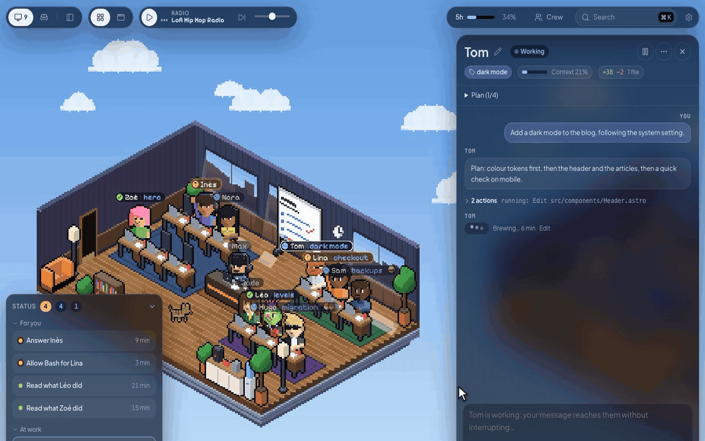

Chaque session est un perso assis à son poste. Il tape quand il travaille, lève la main quand il a besoin de toi, sourit quand il a fini. Un clic sur lui ouvre son fil, et tu réponds sans changer de fenêtre. Plus besoin de jongler entre six terminaux pour savoir qui attend quoi.

Il lance aussi des sessions tout seul : à heure fixe ou sur un webhook, elles travaillent en petits robots dans une salle des serveurs. Et n'importe quelle session peut te coder un **mod**, une petite fenêtre avec les chiffres qui t'intéressent, à garder ouverte ou à poser sur un dashboard.

Open Space lance le `claude` installé sur ta machine : tes skills, tes plugins, ton `CLAUDE.md` et tes réglages s'appliquent comme dans ton terminal.

## Ton poste

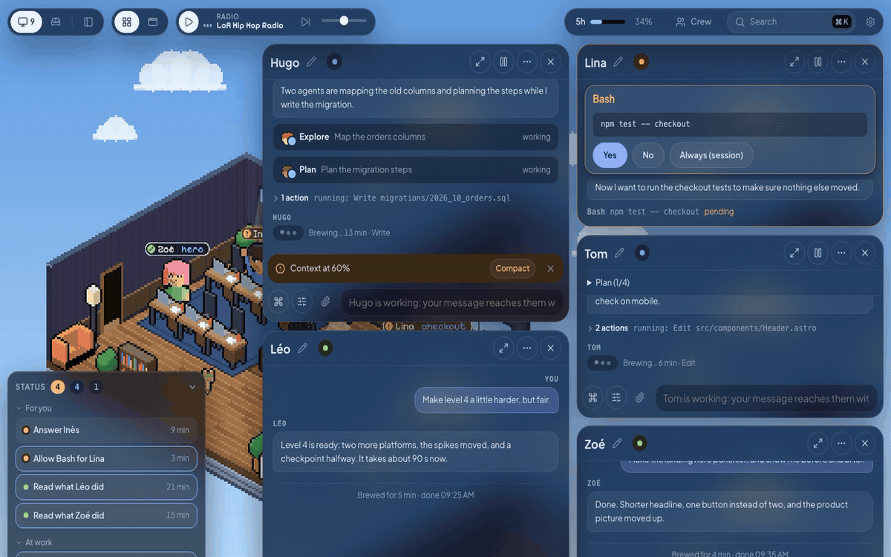

- **Voir qui a besoin de toi.** Le panneau État liste ce qui t'attend et depuis quand, qui travaille, et qui est prêt pour un nouveau message.
- **Ouvrir jusqu'à six conversations** côte à côte. Tab les fait glisser hors de vue pour voir la salle, Tab les ramène.
- **Le mode focus** (Cmd+. sur Mac, Ctrl+. sur Windows) remplace la salle par la liste de tes sessions, rangées selon ce qu'elles attendent. La liste se replie aux seules têtes quand tu veux de la place.
- **Tout chercher** avec Cmd+K sur Mac ou Ctrl+K sur Windows : sessions, messages, commandes et réglages.
- **Être prévenu** par un son et une notification native de l’app macOS ou Windows quand une session a fini ou t'attend, même fenêtre fermée.
- **Continuer sur ton téléphone** avec Remote Control : un bouton, et la session apparaît dans claude.ai/code et l'app Claude.
- **Sortir une fenêtre** : une conversation, un mod ou un navigateur sort d'Open Space dans sa propre fenêtre, gardée au-dessus de tes autres apps (même en plein écran) ou non, et revient d'un clic.

### Range-le à ta façon

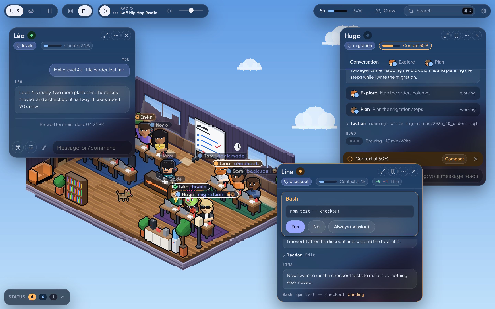

Prends une fenêtre par sa barre de titre pour réordonner la grille, ou passe le bandeau en fenêtres libres et pose chacune où tu veux. Les fenêtres s'aimantent entre elles (Cmd sur Mac ou Ctrl sur Windows enfoncé pour couper) ; lâchée contre un bord, une fenêtre prend la moitié de l'écran, dans un coin le quart, en haut tout l'écran. Retour à la grille, tout se range.

Alt (Option sur Mac) + glisser déplace la salle ; Alt + molette ou le pincement la zoome. Tailles et positions restent d'une visite à l'autre.

## Dans la conversation

- **Répondre sans terminal** : les autorisations (Oui, Non, Toujours) et les questions de Claude, une par onglet comme dans Claude Code.
- **Écrire pendant qu'une session travaille.** Ton message rejoint le tour en cours (Claude le lit à sa prochaine étape). `/btw ta question` pose une question à côté sans encombrer le fil.
- **Joindre n'importe quel fichier** : coller une capture avec Cmd+V sur Mac ou Ctrl+V sur Windows, glisser des fichiers, ou passer par le trombone. Les images partent comme images, un zip ou un PDF part avec son chemin.
- **Taper `/`** pour choisir une commande ou un skill du dossier de la session, avec ses options. Taper `!` pour lancer une commande shell dans ce dossier.
- **Changer le modèle, l'effort et les permissions** d'une session dans un seul panneau, même en pleine tâche.
- **Suivre les sous-agents** : leurs têtes sur l'étiquette de la session, un onglet pour chacun, puis son rapport.
- **Voir ce qui a changé** : `+X −Y` dans l'en-tête, puis chaque fichier avec son diff.
- **Surveiller le contexte** : une jauge se remplit et le champ propose de compacter. `/context`, `/mcp` et `/usage` s'ouvrent en vues dans la page.
- **Voir ce que Claude t'envoie** : images, schémas, vidéos, pages Markdown et HTML s'affichent dans le fil. Une page publiée sur claude.ai s'affiche en aperçu vivant.
- **Donner une clé sans la montrer.** Quand une session a besoin d'une clé d'API, une boîte s'ouvre dans le fil : tu colles la valeur, l'agent n'en a que le nom. Avec `os-secret`, il l'écrit dans un `.env`, lance une commande avec, ou la pose en cookie dans son navigateur, sans jamais la lire. Les clés restent en mémoire, 12 h au plus, et partent quand la session s'éteint.

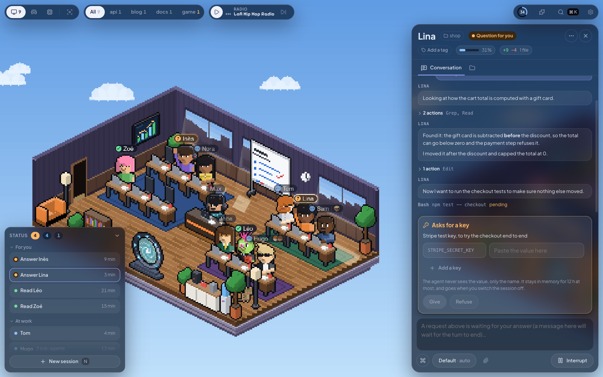

- **Faire parler les sessions entre elles** par leur prénom (« demande à Margot où elle en est »).
- **Envoyer une session en salle de repos** : elle libère son processus et revient avec ton prochain message. **La dupliquer** pour tenter une autre piste pendant que l'originale continue.

## Une branche par session

Plusieurs sessions dans le même projet ne se marchent plus dessus. Quand une autre session travaille déjà dans le dossier, le lanceur propose **Isoler sur une branche**, déjà coché : la nouvelle session part sur sa propre branche (`os/lina-apple-pay`), dans son propre dossier (un worktree git dans `.claude/worktrees/`), avec les `.env` et les `node_modules` du projet copiés (en un instant sur Mac).

- **Tu ne touches jamais à git.** Quand elle a fini, une carte « Prête à fusionner dans main » arrive à la fin du fil. **Fusionner** demande à la session de tout regrouper en un commit et de se remettre à jour ; Open Space vérifie, avance `main` et supprime le dossier. La session continue dans le projet, sur `main`. **Ouvrir une PR** pousse la branche et ouvre la pull request avec `gh`.
- **Rien ne se perd sans que tu le saches.** Éteindre une session dont la branche a du travail demande quoi en faire : fusionner puis éteindre, garder la branche (son travail est commité, elle revient si tu reprends la conversation), ou tout jeter.
- **Le ménage** : la pastille de branche, Cmd+K sur Mac ou Ctrl+K sur Windows, puis « Branches », ou un rappel dans le lanceur ouvrent les branches du projet, avec qui, depuis quand, fusionnée ou non. Les fusionnées sont cochées, le reste attend ton accord.
- Le réglage **Isoler les sessions** (Réglages > Sessions) : quand le dossier est déjà pris, toujours, ou jamais. Le panneau des réglages de la session (Dossier : Partagé / Isolé) force le choix pour une session.

## Automates

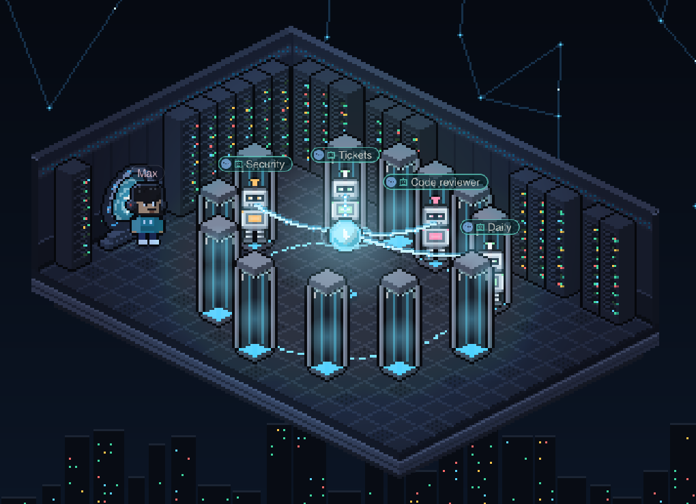

Un **déclencheur** lance une session tout seul : à heure fixe (un cron à 5 champs, à ton heure) ou quand un autre programme appelle son webhook (un ticket Jira qui t'est assigné, un bouton dans un mod). Il a un nom, un dossier de projet, un message de départ, et au choix un agent de ton équipe ou un rôle Claude Code (`.claude/agents/<rôle>.md`), un modèle, un mode de permission et Remote Control.

- **De vraies sessions.** Un run est une session Open Space normale : tu y réponds, tu valides, tu la reprends comme les autres. Pendant qu'il travaille, il se tient en robot dans la salle des serveurs ; le portail du bureau t'y emmène.
- **Dans les limites que tu fixes** : les règles de permission qu'il a sans demander (lire le code, modifier les fichiers, scripts npm, commit, push, ouvrir une PR…), un plafond en dollars et en minutes, et les clés qu'il peut utiliser avec `os-secret` sans les voir.
- **Tester avant de l'allumer** : « Lancer maintenant », et pour un webhook « Simuler un appel », qui le lance en mode plan avec un faux corps.
- **Depuis Telegram** : ajoute ton bot, et les sessions que tu suis t'envoient leurs permissions et leurs questions avec des boutons, leurs fichiers et leur fin. Réponds à un message pour écrire à sa session, ou `/run <déclencheur>` et `/new <dossier> <tâche>` pour en lancer une.
- **Depuis une session ou un autre programme** : le serveur MCP `open-space` permet à une session de créer des déclencheurs, des sessions, des membres d'équipe et des mods. Un autre programme de ton ordinateur peut s'en servir aussi, une fois l'accès externe activé dans le panneau Automates.

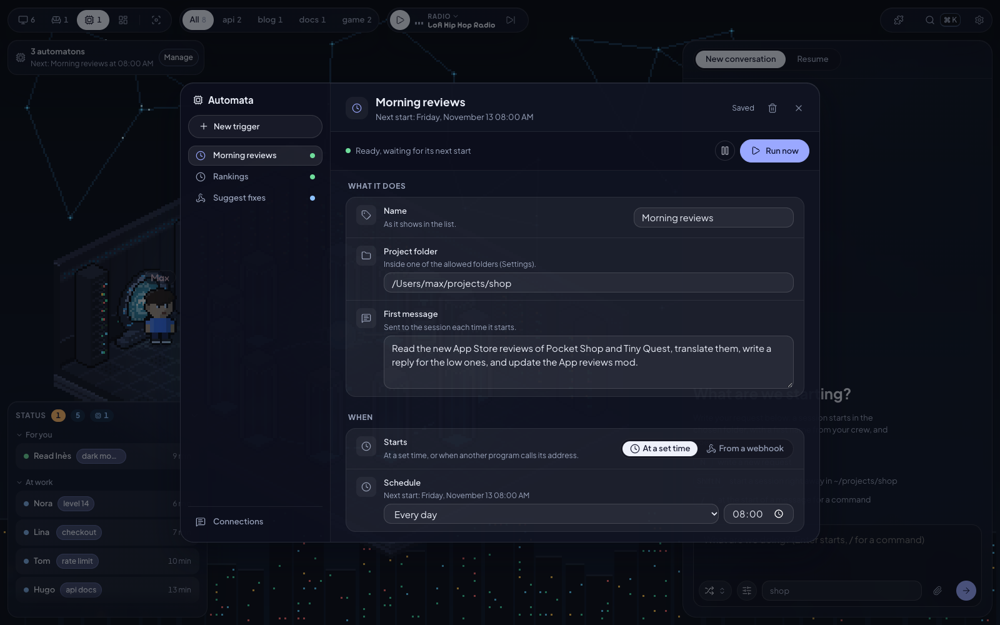

## Mods et dashboards

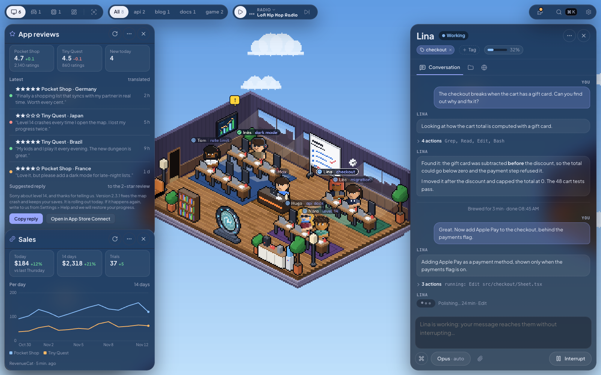

Un **mod** est une petite fenêtre qu'une session te code à partir d'une phrase : « un mod qui montre mes avis App Store, traduits, avec une réponse prête pour chacun ». Ouvre-le quand tu veux, place-le où tu veux, replie-le, range-le dans la grille ou sors-le. Pour le changer, redemande : le bouton crayon envoie ta demande à sa session.

- Les mods sont de simples pages HTML dans `~/.open-space/mods/<id>/`, faites avec un kit de composants testés à toutes les largeurs. Une session ou un script écrit leurs chiffres dans `data/`, et la fenêtre se rafraîchit toute seule (toutes les 1 à 60 minutes) ou avec son bouton.
- Les réglages gardent le nom, l'icône, le rythme et les variables d'environnement de chaque mod (les clés d'API restent hors du dossier que lit l'agent).
- Un mod peut porter un bouton qui lance un déclencheur : « Proposer des fixes » dans un mod de classements réveille une session qui fait la recherche.
- Chaque mod a son origine à lui : il peut intégrer un lecteur YouTube ou un autre site qui l'autorise.

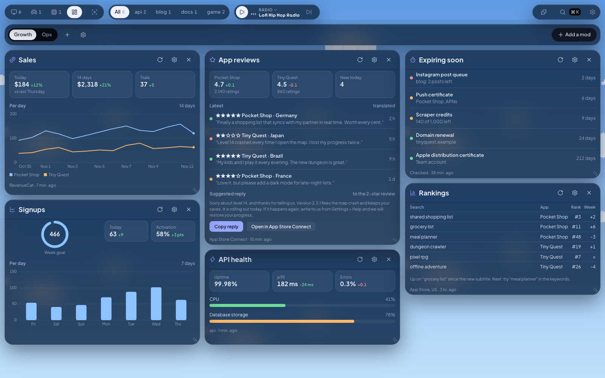

Les **dashboards** posent tes mods sur une grille de 12 colonnes, façon Grafana, en pleine largeur et qui défile vers le bas. Une tuile se déplace par son titre et se redimensionne par son coin, et tu peux en avoir plusieurs. Une tuile et la fenêtre du mod sont indépendantes : ouvrir l'une ne retire pas l'autre.

## Un navigateur par session

Chaque session a son propre navigateur Chromium, qu'elle pilote avec Playwright. Quand elle ouvre une page, une mini-fenêtre la montre en direct : déplace-la, redimensionne-la, clique dedans si l'agent bloque sur une connexion, ou ouvre la vue complète dans le fil (ordinateur 1920×1080 ou mobile 390×844). Pour un test plus large, quatre testeurs (`browser-tester-1` à `-4`) font quatre parcours en même temps, chacun dans son navigateur.

## Ton équipe

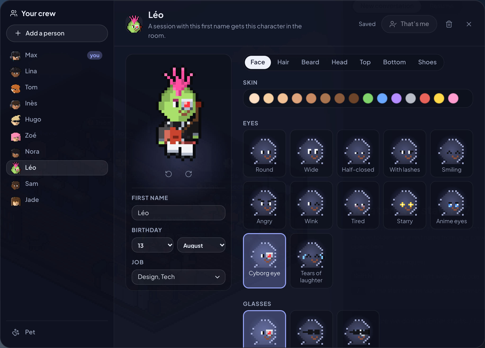

Tu crées ton perso au premier lancement, puis toute ton équipe : 28 coiffures, 34 hauts, 22 chapeaux, 18 accessoires (jetpack, perroquet sur l'épaule, katana, guitare…), des peaux de toutes les couleurs, et des tenues d'anime à porter pièce par pièce. Une session au prénom d'un membre prend son look.

Donne-leur un anniversaire et les salles leur font une fête. Donne-leur un métier (Tech, Design, Data, Cyber…) : une demande lancée sans choisir personne part à un membre libre dont le métier colle.

Choisis un animal parmi 25 : un chat, un chien (7 races), un renard, un hibou, un dragon, un slime, un canard en plastique pour déboguer, Rocky de *Projet Dernière Chance*, Clawd… Clique dessus, il te répond à sa façon.

## Ta salle

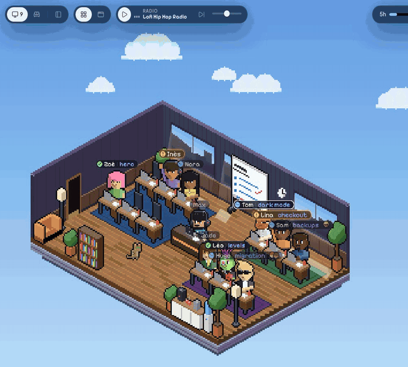

Sept thèmes dans **Réglages > Bureau** : une navette spatiale, une rue de Tokyo au néon, un donjon, un bar de plage, un bateau pirate, une cabane en forêt et une cave de hackers. Murs, sol, meubles, ciel et lumières changent, au bureau comme en salle de repos.

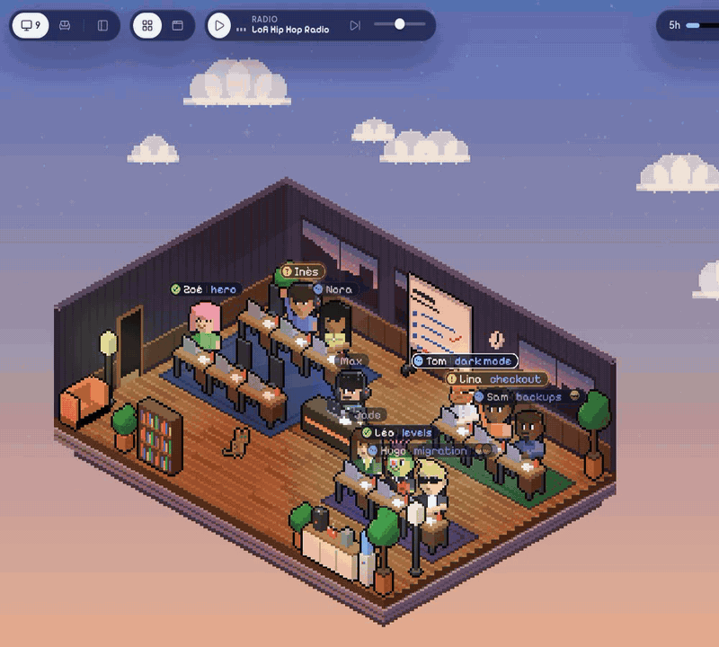

Le ciel suit ton heure : nuages le jour, étoiles et bureau éclairé la nuit. Les salles se déguisent pour 14 occasions, de Noël et Halloween à Songkran et à l'anniversaire de chaque membre de l'équipe. L'icône calendrier du bandeau permet de toutes les essayer.

Dans le bureau, clique sur l'écran de ton poste pour ouvrir un terminal, et sur le tableau blanc pour lire et modifier tes notes (un onglet par fichier Markdown de `~/Journal`, que tes sessions peuvent aussi remplir ; le dossier se change dans les Réglages). Indique un fichier de chiffres dans les Réglages et une pile de billets apparaît sur ton bureau, avec un « ! » rouge quand le fichier a changé. La radio joue du lo-fi, ou pilote Musique ou Spotify (sous Windows : lecture, pause et morceau suivant ou précédent seulement, le lecteur ouvert).

## Installer

Il te faut **Claude Code installé et connecté** ([la doc de Claude Code](https://code.claude.com/docs) explique comment).

### Sur Mac

Télécharge le `.dmg` de la [dernière version](https://github.com/Fantomiald/open-space/releases/latest) : `arm64` pour les Mac Apple Silicon, `x64` pour les Mac Intel. Glisse Open Space dans Applications et ouvre-le. L'app est signée et notarisée, et se met à jour toute seule.

Fermer la fenêtre laisse tourner tes sessions : l'icône du Dock la rouvre et les notifications arrivent toujours. Quitter l'app les arrête, et elles reprennent au prochain lancement.

### Sur Windows

Télécharge `Open Space-Setup-<version>-x64.exe` de la [dernière version](https://github.com/Fantomiald/open-space/releases/latest) et lance-le. L'app se met à jour toute seule. Claude Code doit être installé et connecté ; Node.js n'est pas nécessaire.

L'installateur n'est pas encore signé : si SmartScreen prévient, clique sur **Informations complémentaires** puis **Exécuter quand même**.

Fermer la fenêtre laisse tourner tes sessions : l’icône dans la zone de notification permet de la rouvrir. Pour arrêter l’app, fais un clic droit sur cette icône puis choisis **Quitter Open Space**. Les sessions reprennent au prochain lancement.

### Lancer depuis le code

Il te faut **Node.js 22.18 ou plus récent** et Git (**Git pour Windows** sous Windows).

```bash
git clone https://github.com/Fantomiald/open-space.git
cd open-space
npm ci --ignore-scripts
npm start
```

`npm start` construit l'interface, démarre le serveur et ouvre **http://127.0.0.1:4848**. La première fois, le lien « Autoriser un navigateur » s'ouvre aussi : il pose un cookie valable 400 jours. Si l’app de bureau est installée, elle peut se connecter à ce serveur au lieu de lancer le sien.

Le premier lancement demande ton prénom et ton perso, les dossiers où les sessions peuvent travailler, puis tes habitudes (modèle, permissions, son, animal). L'interface est en français ou en anglais selon ton navigateur, et tout se change dans les **Réglages**.

## Sécurité

- Le serveur n'écoute que sur `127.0.0.1` et refuse tout navigateur sans le cookie d'autorisation.
- Les sessions ne travaillent que dans les dossiers que tu as choisis.
- Un dossier dont les réglages font tourner du code (hooks, serveurs MCP du projet) ne démarre qu'avec ton accord. Sans ton accord, la session tourne sans ces réglages.
- Les variables `ANTHROPIC_*` et tes autres secrets de shell ne sont pas transmis aux sessions. Le serveur n'appelle rien sur internet (la radio passe directement par ton navigateur).
- Les nouvelles sessions démarrent en mode **Auto** : Claude décide, et te demande quand quelque chose est risqué. Choisis « Demande à chaque fois » dans les Réglages pour tout valider.

## Bon à savoir

- L’app de bureau prend en charge macOS et Windows. Le navigateur piloté par les agents demande un navigateur Chromium (Chrome, Edge, Arc).
- Open Space s'appuie sur `claude -p` en mode stream-json, dont certaines options ne sont pas documentées. Une version plus récente de Claude Code peut casser une fonction : [ouvre une issue](https://github.com/Fantomiald/open-space/issues) si ça t'arrive.
- Les commentaires du code et la doc interne ([ARCHITECTURE.md](docs/ARCHITECTURE.md), [CLAUDE.md](CLAUDE.md)) sont en partie en français.

<details>
<summary><b>Réglages avancés</b></summary>

| Variable | Rôle | Par défaut |
|---|---|---|
| `OFFICE_ROOTS` | Dossiers autorisés, séparés par `:` sur macOS ou `;` sur Windows. Remplace ceux choisis dans la page | ceux de l'onboarding |
| `OFFICE_DIR` | Où vivent tes données (équipe, sessions, journaux) | `~/.open-space` sur macOS ; `%USERPROFILE%\.open-space` sur Windows |
| `PORT` | Port du serveur | `4848` |
| `OFFICE_MAX_LIVE` | Sessions Claude Code qui tournent en même temps | `12` |
| `OFFICE_IDLE_MINUTES` | Au-delà, une session inactive libère son processus (elle reprend au prochain message) | `30` |
| `OFFICE_ENV_PASSTHROUGH` | Variables de ton shell à passer en plus aux sessions | aucune |

</details>

<details>
<summary><b>Développer</b></summary>

| Commande | |
|---|---|
| `npm start` | build + serveur + navigateur |
| `npm run dev` | serveur + Vite avec rechargement à chaud (http://localhost:5174) |
| `npm run check` | types : client, serveur et app |
| `npm run lint` | linter ([Biome](https://biomejs.dev), règles expliquées dans `biome.jsonc`) |
| `npm test` | tests (`node:test`, sans dépendance) |
| `npm run app:dev` | l’app de bureau depuis le repo, sans l’empaqueter (macOS ou Windows) |
| `npm run app:win` | un installateur Windows NSIS x64 dans `release/` |
| `npm run app:win:arm64` | un installateur Windows NSIS ARM64 dans `release/` |
| `npm run app` | un `.dmg` Apple Silicon et Intel, signé ad hoc (sur un autre Mac : **Réglages Système > Confidentialité et sécurité > Ouvrir quand même**) |
| `npm run app:release` | pareil, signé avec un certificat « Developer ID Application » et notarisé par Apple : demande une clé API App Store Connect dans `APPLE_API_KEY` (chemin du `.p8`), `APPLE_API_KEY_ID` et `APPLE_API_ISSUER` |
| `npm run app:publish` | pareil, envoyé sur une release GitHub en brouillon (`GH_TOKEN`) ; les apps installées se mettent à jour depuis la dernière release publiée |

Pour construire l’app Windows depuis le code, installe Git pour Windows et Node.js 22.18 ou plus récent, puis exécute dans PowerShell :

```powershell
git clone https://github.com/Fantomiald/open-space.git
cd open-space
npm ci
npm run app:win
```

L’installateur x64 est créé dans `release/`. Pour ARM64, utilise `npm run app:win:arm64`. Les installateurs locaux ne sont pas signés.

Le fonctionnement interne (serveur, protocole, bureau, et ce qui a été vérifié sur un vrai Claude Code) est décrit dans [docs/ARCHITECTURE.md](docs/ARCHITECTURE.md). Les règles pour modifier le code sont dans [CLAUDE.md](CLAUDE.md).

</details>

## Crédits

- Parti de [bureau-des-agents](https://github.com/devlikemasta/bureau-des-agents) (MIT). Le serveur, le protocole et l'interface ont été réécrits ; le copyright d'origine reste dans [LICENSE](LICENSE).
- Polices [Pixelify Sans](https://fonts.google.com/specimen/Pixelify+Sans), [Fredoka](https://fonts.google.com/specimen/Fredoka) et [Plus Jakarta Sans](https://fonts.google.com/specimen/Plus+Jakarta+Sans) (OFL), icônes [Lucide](https://lucide.dev) (ISC).
- Les tenues d'anime sont un clin d'œil de fan à *Naruto* et *One Piece*, sans lien avec leurs auteurs ni leurs éditeurs. Rocky vient du roman d'Andy Weir *Projet Dernière Chance*, même esprit.
- Clawd est la mascotte de Claude Code, dessinée ici en clin d'œil de fan. Open Space n'est pas un produit d'Anthropic. Claude et Claude Code sont des marques d'Anthropic.

Licence MIT, par [Fantomiald](https://github.com/Fantomiald).
