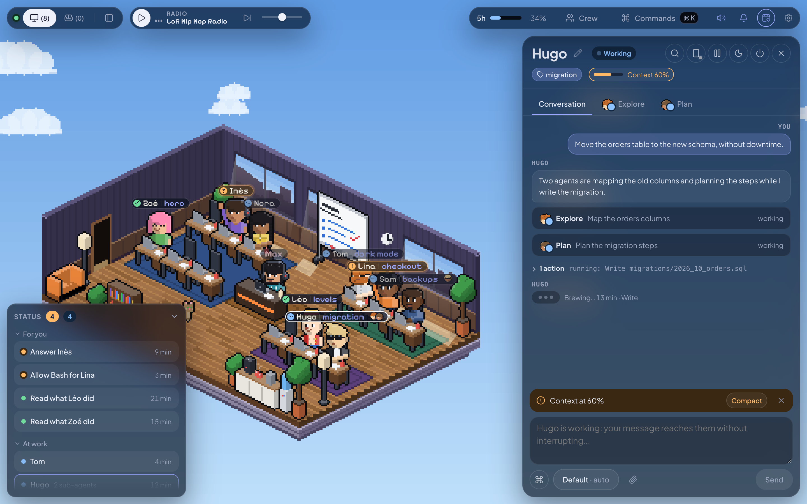
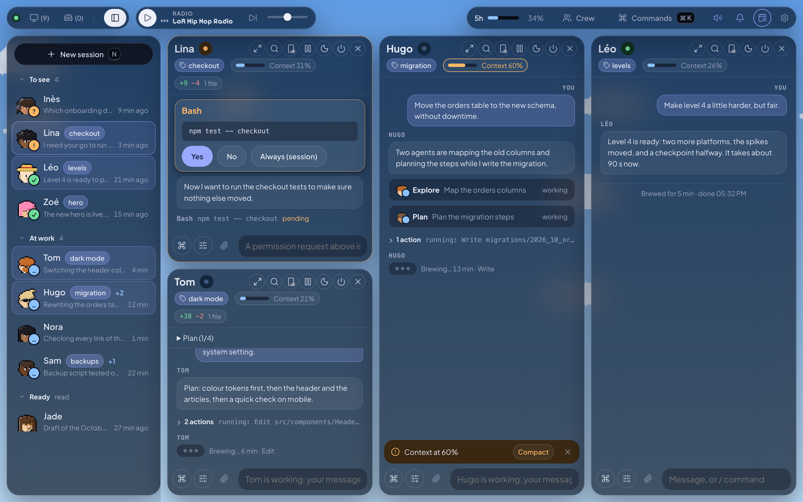
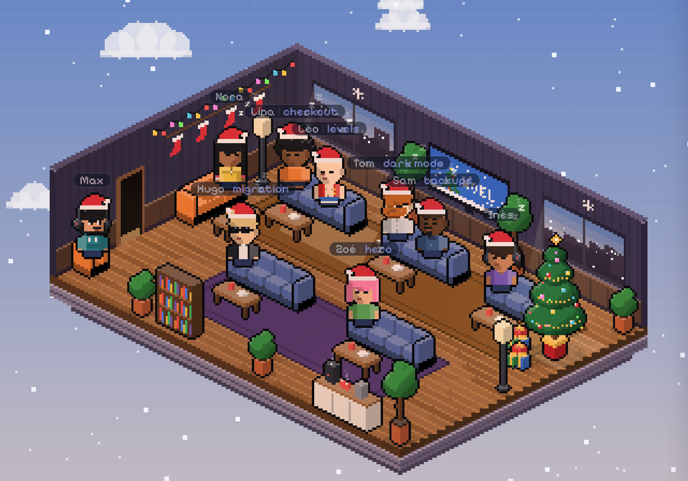

# Open Space

**English** · [Français](README.fr.md)

A pixel-art office to run several Claude Code sessions at once, from your browser.



Each session is a character at a desk. They type while they work, raise a hand when they need you, and smile when they're done. Click one to open its thread on the right and answer without switching windows. No more juggling six terminals to find out who is waiting on what.

Open Space runs the `claude` installed on your machine. Your skills, plugins, `CLAUDE.md` and Claude Code settings apply just as they do in your terminal.

## What you can do

### Run your sessions

- **Start sessions** in your project folders, each with a first name from your crew and a tag if you like. The label above each agent shows both, with their status. Their answers stream into the thread.
- **See where everyone is at** in the Status panel, bottom left: what waits for you and for how long, who is at work and for how long, who is ready for a new message.
- **Open several at once**: Shift+click an agent to open its conversation next to the others, up to six. Tab slides them aside to see the room, Tab brings them back.
- **Switch to focus mode** (the icon in the top bar, or Cmd+.): the room gives way to the list of all your sessions, grouped by what they need, and the ones you open line up side by side. Handy when someone is looking at your screen.
- **Change the model, the effort and the permissions** of a session from one panel under its field, at once and even mid-task. Ultracode is there too, per session, when dynamic workflows are on in Claude Code.
- **Get notified** by a sound and a macOS notification when a session is done or waiting for you, even with the tab closed.
- **Send a session to the break room**: it lets go of its process and comes back with your next message.
- **Continue on your phone** with Remote Control: one button, and the session shows up in claude.ai/code and the Claude app.

### In the conversation

- **Answer without a terminal**: permissions (Yes, No, Always) and Claude's questions, one tab each as in Claude Code.
- **Write while a session works**: your message joins the running turn without interrupting it (Claude reads it at its next step); a `/` command waits for the turn to end, or leaves at once with "Send now". `/btw your question` asks a side question without interrupting or cluttering the conversation.
- **Attach any file**: paste a screenshot (Cmd+V), drop files on the panel, or use the paperclip. Pictures go to Claude as pictures; a zip, a PDF or a CSV goes as its path, which Claude opens with its tools, as in the terminal.
- **Type `/` anywhere in a message** to pick a command: the field knows the commands and skills of the session's folder, with their options (`/model`, `/effort`, a skill's sub-commands).
- **Run a shell command** by typing `!` first. It runs in the session's folder without Claude, who sees it with your next message, as in the terminal.
- **Keep an unsent message**: what you type stays in each session's field when you switch from one session to another.
- **Search** a thread with Cmd+F, copy a code block in one click.

### Follow the work

- **Let sessions talk to each other**: each one carries its first name and the others find it by that name ("ask Margot where things stand"). Their messages show in the thread.
- **Follow sub-agents**: their faces on the session's label, a tab for each one at work with what it writes, then its report under "Done". A session whose sub-agents work in the background keeps typing at its desk.
- **See what a session changed**: `+X −Y` in its header, then each file with its diff, as in Claude Code.
- **Watch the context**: a gauge in the session's header changes colour as the conversation fills up, and the field offers to compact. `/context` shows what fills it, with buttons to compact or start over (`/compact`, `/clear`).
- **Claude Code's views in the page**: `/mcp` lists the MCP servers and lets you reconnect, sign in to or turn off each one; `/usage` shows your limits and your week.
- **See the files Claude sends you** in the thread: pictures and SVG diagrams, videos, Markdown and text files, HTML pages as a live preview, full size in one click. Other files download. A page Claude publishes on claude.ai (an artifact) shows as a live preview: click it to see it large, or open it on claude.ai.

### Around the office

- **Open a terminal** by clicking the screen on your own desk.
- **Read and edit your daily notes** on the office whiteboard: one tab per Markdown file of `~/Journal` (or the folder set in Settings), which your sessions can fill too.
- **Keep an eye on a file of numbers** (optional): set a Markdown file in Settings and a pile of banknotes shows up on your desk; a click shows the file, a red "!" floats above it when it changed since you last looked.
- **Put on some music**: the radio in the top bar plays lo-fi web radios. On a Mac it can drive Music or Spotify instead, with the cover, the track and, for Music, your playlists.

The whiteboard shows the `.md` files of your notes folder, one tab per file, and you can write in them right there. Your Claude sessions can keep them up to date too: add to your `CLAUDE.md` a line like `When a task is done, add a line to ~/Journal/<project>.md`. The numbers object works the same way with any Markdown file your scripts or a session rewrite (numbers, stats, tracking); leave its setting empty and it stays out of the office.



## Your crew, your office

You create your own character on first launch, then your whole crew under **Crew**: 17 hairstyles, 9 beards, 14 tops, hats, sunglasses, skin of every colour, and anime outfits (Naruto, Zoro, Luffy, Sanji, Kakashi) to wear piece by piece. A session named after a crew member takes on their look. Give them a job (Tech, Cyber, Product, HR…): a request started without picking someone goes to a free member whose job fits, or you pick them yourself in the launcher.

A pet wanders around the office: a cat, a dog (7 breeds), a rubber duck for debugging, a capybara, an axolotl, Rocky from *Project Hail Mary*, or Clawd, Claude Code's mascot. Click it and it answers in its own way.

The office floats in a pixel-art sky that follows the time of day: drifting clouds, stars and moon at night, snow at Christmas, fireworks at New Year and on Bastille Day. It dresses up for 14 occasions: Christmas, Halloween, Chinese New Year, Songkran, Bastille Day, and the birthday of each member of your crew. The calendar icon in the top bar lets you try them all.



## Install

You need **Node.js 22.18 or later** and **Claude Code installed and signed in** ([the Claude Code docs](https://code.claude.com/docs) explain how).

```bash
git clone https://github.com/Fantomiald/open-space.git
cd open-space
npm ci --ignore-scripts
npm start
```

`npm start` builds the interface, starts the server and opens your browser at **http://127.0.0.1:4848**. Bookmark it: the address doesn't change, and an open tab reconnects by itself when the server restarts. The very first time, the "Allow a browser" link opens too: it sets a cookie that stays valid for 400 days.

The first launch asks four things: your first name and your character, the folders sessions may work in (Open Space suggests those that hold projects), then your habits: default model and permissions, sound, notifications, pet. Everything can be changed later under **Crew** and **Settings**.

The interface follows your browser's language, French or English. You can switch it in **Settings**.

### On a Mac: the Dock app

```bash
pip3 install pillow
python3 scripts/macos-app.py
```

This creates `~/Applications/Open Space.app`, with your character as its icon. Opening it starts the server and the page; quitting it stops the server. Notifications then show under its name, with your character. Run the script again if you change your look or move the project.

## Security

- The server only listens on your machine (`127.0.0.1`) and refuses any browser without the authorization cookie.
- Sessions only work in the folders you chose.
- A folder whose settings run code (hooks, the project's MCP servers) only starts once you agree. Without your agreement, the session runs without those settings.
- `ANTHROPIC_*` variables and your other shell secrets aren't passed to sessions. The server makes no call to the internet (the radio plays straight in your browser).
- New sessions start in **Auto** mode: Claude decides, and asks you when something is risky. Pick "Asks every time" in Settings if you'd rather approve everything.

## Advanced settings

| Variable | Purpose | Default |
|---|---|---|
| `OFFICE_ROOTS` | Allowed folders, separated by `:`. Replaces the ones chosen in the page | those from onboarding |
| `OFFICE_DIR` | Where your data lives (crew, sessions, logs) | `~/.open-space` |
| `PORT` | Server port | `4848` |
| `OFFICE_MAX_LIVE` | Claude Code sessions running at the same time | `8` |
| `OFFICE_IDLE_MINUTES` | After this long, an idle session releases its process (it resumes with the next message) | `30` |
| `OFFICE_ENV_PASSTHROUGH` | Extra variables from your shell to pass to sessions | none |

## Good to know

- Tested on macOS with Chromium browsers (Chrome, Arc). Notifications, the Dock app and the Music and Spotify remote are macOS only.
- Open Space relies on `claude -p` in stream-json mode, some of whose options are undocumented. Everything was checked with Claude Code 2.1.302 and 2.1.303: a newer version may break a feature. Please open an issue if that happens to you.
- The code's comments and the internal docs ([ARCHITECTURE.md](docs/ARCHITECTURE.md), [CLAUDE.md](CLAUDE.md)) are partly in French.

## Develop

| Command | |
|---|---|
| `npm start` | build + server + browser |
| `npm run dev` | server + Vite with hot reload (http://localhost:5174) |
| `npm run check` | types, client and server |
| `npm run lint` | linter ([Biome](https://biomejs.dev), rules explained in `biome.jsonc`) |
| `npm test` | tests (`node:test`, no dependency) |
| `npm run build` | build the interface |

How it works inside (server, protocol, office, and what was checked against a real Claude Code) is described in [docs/ARCHITECTURE.md](docs/ARCHITECTURE.md). The rules to follow when changing the code are in [CLAUDE.md](CLAUDE.md).

## Credits

- Started from [bureau-des-agents](https://github.com/devlikemasta/bureau-des-agents) (MIT). The server, protocol and interface were rewritten; the original copyright stays in [LICENSE](LICENSE).
- Fonts [Pixelify Sans](https://fonts.google.com/specimen/Pixelify+Sans) and [Plus Jakarta Sans](https://fonts.google.com/specimen/Plus+Jakarta+Sans) (OFL), icons [Lucide](https://lucide.dev) (ISC).
- The anime outfits are a fan's nod to *Naruto* and *One Piece*, with no connection to their authors or publishers.
- Rocky comes from Andy Weir's novel *Project Hail Mary*: a fan's nod, with no connection to the author or the publisher.
- Clawd is Claude Code's mascot, drawn here as a fan's nod. Open Space isn't an Anthropic product. Claude and Claude Code are trademarks of Anthropic.

MIT licence, by [Fantomiald](https://github.com/Fantomiald).
