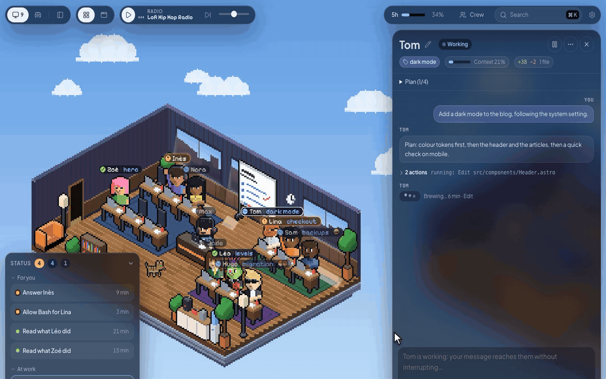
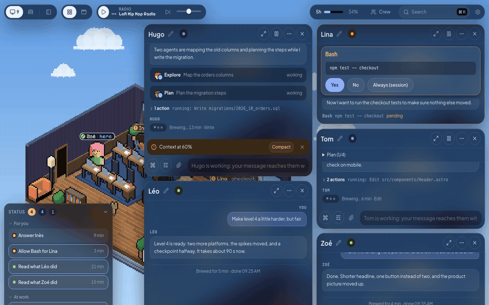
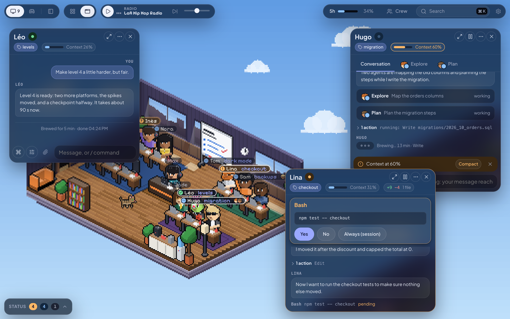
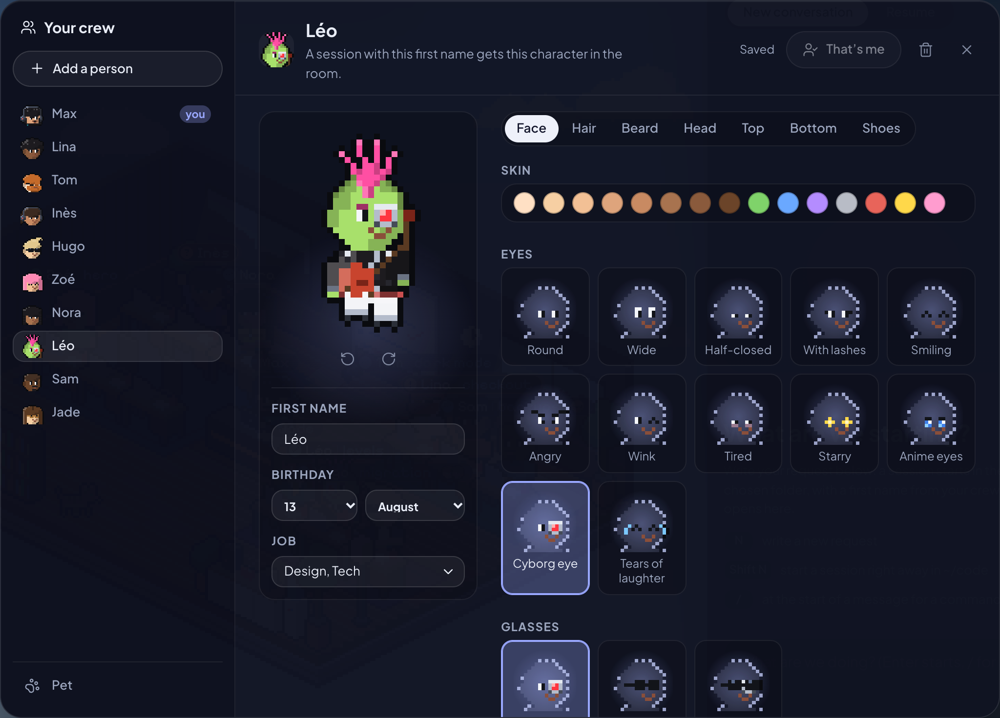
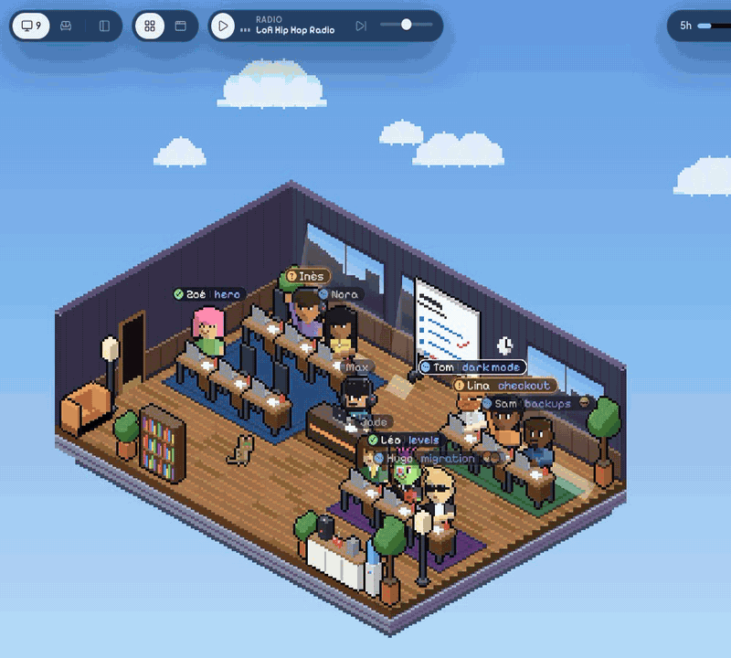
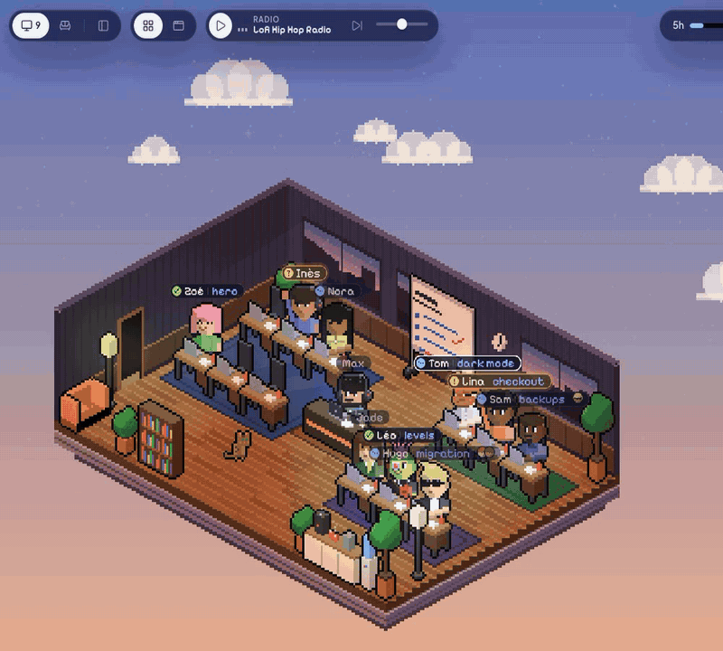

# Open Space

**English** · [Français](README.fr.md)

A pixel-art office to run several Claude Code sessions at once.

[](https://github.com/Fantomiald/open-space/releases/latest)


[](LICENSE)

**[Install on Mac or Windows](#install)** · [Run from source](#run-from-source) · [What's new](CHANGELOG.md) (in French)



Each session is a character at a desk. They type while they work, raise a hand when they need you, and smile when they're done. Click one to open its thread and answer without switching windows. No more juggling six terminals to find out who is waiting on what.

Open Space runs the `claude` installed on your machine, so your skills, plugins, `CLAUDE.md` and settings apply just as they do in your terminal.

## Your desk



- **See who needs you.** The Status panel lists what waits for you and for how long, who is working, and who is ready for a new message.
- **Open up to six conversations** side by side. Tab slides them aside to see the room, Tab brings them back.
- **Focus mode** (Cmd+. on Mac, Ctrl+. on Windows) swaps the room for the list of your sessions, grouped by what they need. The list folds down to faces when you want more room.
- **Search everything** with Cmd+K on Mac or Ctrl+K on Windows: sessions, messages, commands and settings.
- **Get notified** by a sound and a native macOS or Windows app notification when a session is done or waiting, even with the window closed.
- **Continue on your phone** with Remote Control: one button, and the session shows up in claude.ai/code and the Claude app.

### Arrange it your way



Drag a window by its title bar to reorder the grid, or switch the top bar to free windows and put each one wherever you like. Windows snap to each other (hold Cmd on Mac or Ctrl on Windows to turn that off); drop one on a screen edge for half the screen, in a corner for a quarter, at the top for all of it. Back to the grid, everything tidies itself.

Alt (Option on Mac) + drag moves the room; Alt + scroll or pinch zooms it. Sizes and positions are kept between visits.

## In the conversation

- **Answer without a terminal**: permissions (Yes, No, Always) and Claude's questions, one tab each as in Claude Code.
- **Write while a session works.** Your message joins the running turn (Claude reads it at its next step). `/btw your question` asks something on the side without cluttering the thread.
- **Attach any file**: paste a screenshot with Cmd+V on Mac or Ctrl+V on Windows, drop files, or use the paperclip. Pictures go as pictures, a zip or a PDF goes as its path.
- **Type `/`** to pick a command or a skill of the session's folder, with its options. Type `!` to run a shell command in that folder.
- **Change the model, the effort and the permissions** of a session in one panel, even mid-task.
- **Follow sub-agents**: their faces on the session's label, a tab for each one, then its report.
- **See what changed**: `+X −Y` in the header, then each file with its diff.
- **Watch the context**: a gauge fills up and the field offers to compact. `/context`, `/mcp` and `/usage` open as views in the page.
- **See what Claude sends you**: pictures, diagrams, videos, Markdown and HTML pages show in the thread. A page published on claude.ai shows as a live preview.
- **Let sessions talk to each other** by first name ("ask Margot where things stand").
- **Send a session to the break room**: it lets go of its process and comes back with your next message. **Duplicate** one to try another direction while the original carries on.

## A branch per session

Several sessions in one project no longer step on each other. When another session already works in the folder, the launcher offers **Isolate on a branch**, already checked: the new session starts on a branch of its own (`os/lina-apple-pay`), in a folder of its own (a git worktree in `.claude/worktrees/`), with the project's `.env` files and `node_modules` copied in (instantly on a Mac).

- **You never touch git.** When it is done, a "Ready to merge into main" card shows at the end of the thread. **Merge** asks the session to squash its work into one commit and catch up; Open Space checks, moves `main` on and removes the folder. The session goes on in the project, on `main`. **Open a PR** pushes the branch and opens the pull request with `gh`.
- **Nothing is lost without you knowing.** Switching off a session whose branch has work asks what to do with it: merge then switch off, keep the branch (its work is committed, and it comes back if you resume the conversation), or throw it all away.
- **Tidying up**: the branch pill, Cmd+K on Mac or Ctrl+K on Windows, then "Branches", or a reminder in the launcher open the project's branches, with who, how old, merged or not. The merged ones are checked, the rest waits for your word.
- The **Isolate sessions** setting (Settings > Sessions): when the folder is taken, always, or never. The session's settings panel (Folder: Shared / Isolated) forces it for one session.

## Your crew



You create your own character on first launch, then your whole crew: 28 hairstyles, 34 tops, 22 hats, 18 accessories (jetpack, parrot on the shoulder, katana, guitar…), skin of every colour, and anime outfits to wear piece by piece. A session named after a crew member takes on their look.

Give them a birthday and the rooms throw them a party. Give them a job (Tech, Design, Data, Cyber…): a request started without picking someone goes to a free member whose job fits.

Pick a pet among 25: a cat, a dog (7 breeds), a fox, an owl, a dragon, a slime, a rubber duck for debugging, Rocky from *Project Hail Mary*, Clawd… Click it and it answers in its own way.

## Your room



Six themes under **Settings > Office**: a space shuttle, a neon Tokyo street, a dungeon, a beach bar, a pirate ship and a treehouse. Walls, floor, furniture, sky and lights all change, in the office and in the break room.



The sky follows your clock: clouds by day, stars and a lit-up office at night. The rooms dress up for 14 occasions, from Christmas and Halloween to Songkran and each crew member's birthday. The calendar icon in the top bar lets you try them all.

Around the office, click the screen on your desk to open a terminal, and the whiteboard to read and edit your notes (one tab per Markdown file of `~/Journal`, which your sessions can fill too; the folder is set in Settings). Point Settings at a file of numbers and a pile of banknotes shows up on your desk, with a red "!" when the file changed. The radio plays lo-fi, or drives Music or Spotify (on Windows: play, pause and skip only, with the player open).

## Install

You need **Claude Code installed and signed in** ([the Claude Code docs](https://code.claude.com/docs) explain how).

### On a Mac

Download the `.dmg` from the [latest release](https://github.com/Fantomiald/open-space/releases/latest): `arm64` for Apple Silicon, `x64` for Intel. Drag Open Space into Applications and open it. It is signed and notarized, and it updates itself.

Closing the window keeps your sessions running: the Dock icon brings it back and notifications still come. Quitting stops them, and they resume at the next launch.

### On Windows

Download the `.exe` installer from the [latest release](https://github.com/Fantomiald/open-space/releases/latest): `x64` for an Intel/AMD PC, `arm64` for Windows on ARM. Run `Open Space-Setup-<version>-<architecture>.exe` and follow the installation wizard. Node.js is not needed to use the installed app; Claude Code must be installed and signed in.

If the installer is unsigned, Windows may display a SmartScreen warning.

Closing the window keeps your sessions running: the notification-area icon brings it back. To stop the app, right-click that icon and choose **Quit Open Space**. Sessions resume at the next launch.

### Run from source

You need **Node.js 22.18 or later** and Git (**Git for Windows** on Windows).

```bash
git clone https://github.com/Fantomiald/open-space.git
cd open-space
npm ci --ignore-scripts
npm start
```

`npm start` builds the interface, starts the server and opens **http://127.0.0.1:4848**. The first time, the "Allow a browser" link opens too: it sets a cookie valid for 400 days. If the desktop app is installed, it can connect to that server instead of starting its own.

The first launch asks your first name and character, the folders sessions may work in, then your habits (model, permissions, sound, pet). The interface is in English or French, following your browser, and both can be changed in **Settings**.

## Security

- The server only listens on `127.0.0.1` and refuses any browser without the authorization cookie.
- Sessions only work in the folders you chose.
- A folder whose settings run code (hooks, the project's MCP servers) only starts once you agree. Without your agreement, the session runs without those settings.
- `ANTHROPIC_*` variables and your other shell secrets aren't passed to sessions. The server makes no call to the internet (the radio plays straight in your browser).
- New sessions start in **Auto** mode: Claude decides, and asks you when something is risky. Pick "Asks every time" in Settings to approve everything.

## Good to know

- The desktop app supports macOS and Windows. The browser driven by agents needs a Chromium browser (Chrome, Edge, Arc).
- Open Space relies on `claude -p` in stream-json mode, some of whose options are undocumented. A newer Claude Code may break a feature: please [open an issue](https://github.com/Fantomiald/open-space/issues) if it does.
- The changelog, the code's comments and the internal docs ([ARCHITECTURE.md](docs/ARCHITECTURE.md), [CLAUDE.md](CLAUDE.md)) are partly in French.

<details>
<summary><b>Advanced settings</b></summary>

| Variable | Purpose | Default |
|---|---|---|
| `OFFICE_ROOTS` | Allowed folders, separated by `:` on macOS or `;` on Windows. Replaces the ones chosen in the page | those from onboarding |
| `OFFICE_DIR` | Where your data lives (crew, sessions, logs) | `~/.open-space` on macOS; `%USERPROFILE%\.open-space` on Windows |
| `PORT` | Server port | `4848` |
| `OFFICE_MAX_LIVE` | Claude Code sessions running at the same time | `8` |
| `OFFICE_IDLE_MINUTES` | After this long, an idle session releases its process (it resumes with the next message) | `30` |
| `OFFICE_ENV_PASSTHROUGH` | Extra variables from your shell to pass to sessions | none |

</details>

<details>
<summary><b>Develop</b></summary>

| Command | |
|---|---|
| `npm start` | build + server + browser |
| `npm run dev` | server + Vite with hot reload (http://localhost:5174) |
| `npm run check` | types: client, server and app |
| `npm run lint` | linter ([Biome](https://biomejs.dev), rules explained in `biome.jsonc`) |
| `npm test` | tests (`node:test`, no dependency) |
| `npm run app:dev` | the desktop app from the repo, without packaging it (macOS or Windows) |
| `npm run app:win` | a Windows NSIS x64 installer in `release/` |
| `npm run app:win:arm64` | a Windows NSIS ARM64 installer in `release/` |
| `npm run app` | a `.dmg` for Apple Silicon and Intel, signed ad hoc (on another Mac: **System Settings > Privacy & Security > Open Anyway**) |
| `npm run app:release` | the same, signed with a "Developer ID Application" certificate and notarized by Apple: needs an App Store Connect API key in `APPLE_API_KEY` (path to the `.p8`), `APPLE_API_KEY_ID` and `APPLE_API_ISSUER` |
| `npm run app:publish` | the same, uploaded to a draft GitHub release (`GH_TOKEN`); installed apps update from the latest published release |

To build the Windows app from source, install Git for Windows and Node.js 22.18 or later, then run in PowerShell:

```powershell
git clone https://github.com/Fantomiald/open-space.git
cd open-space
npm ci
npm run app:win
```

The x64 installer is created in `release/`. For ARM64, use `npm run app:win:arm64`. Local installers are unsigned.

How it works inside (server, protocol, office, and what was checked against a real Claude Code) is in [docs/ARCHITECTURE.md](docs/ARCHITECTURE.md). The rules for changing the code are in [CLAUDE.md](CLAUDE.md).

</details>

## Credits

- Started from [bureau-des-agents](https://github.com/devlikemasta/bureau-des-agents) (MIT). The server, protocol and interface were rewritten; the original copyright stays in [LICENSE](LICENSE).
- Fonts [Pixelify Sans](https://fonts.google.com/specimen/Pixelify+Sans) and [Plus Jakarta Sans](https://fonts.google.com/specimen/Plus+Jakarta+Sans) (OFL), icons [Lucide](https://lucide.dev) (ISC).
- The anime outfits are a fan's nod to *Naruto* and *One Piece*, with no connection to their authors or publishers. Rocky comes from Andy Weir's novel *Project Hail Mary*, same spirit.
- Clawd is Claude Code's mascot, drawn here as a fan's nod. Open Space isn't an Anthropic product. Claude and Claude Code are trademarks of Anthropic.

MIT licence, by [Fantomiald](https://github.com/Fantomiald).
